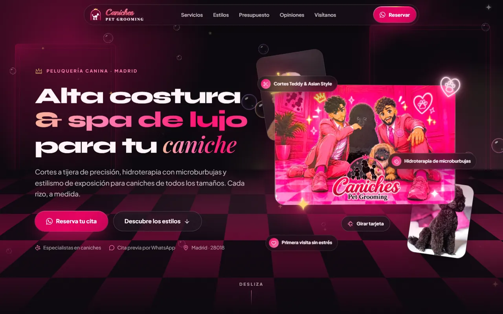
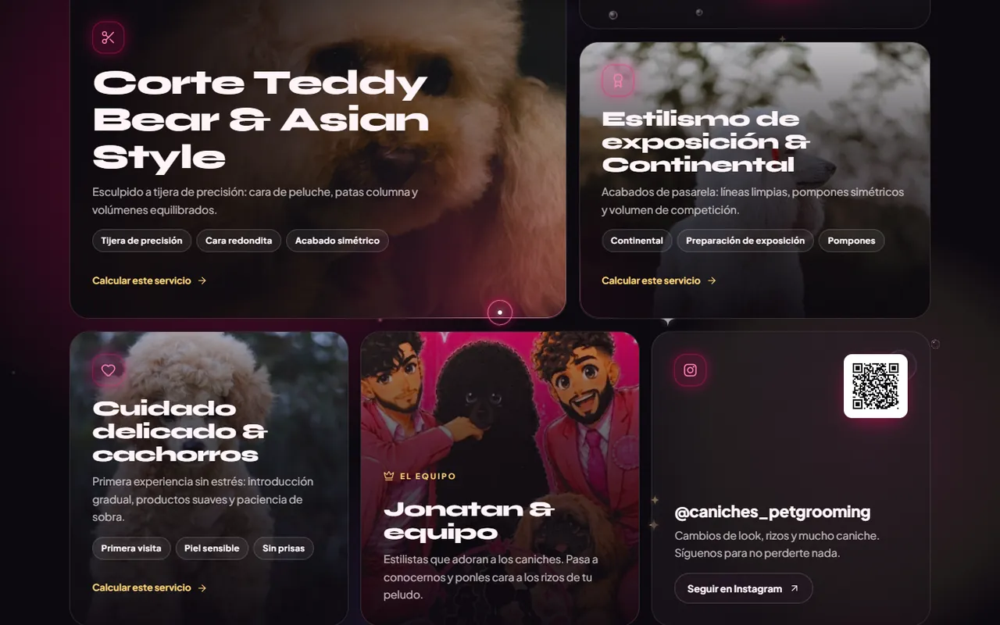
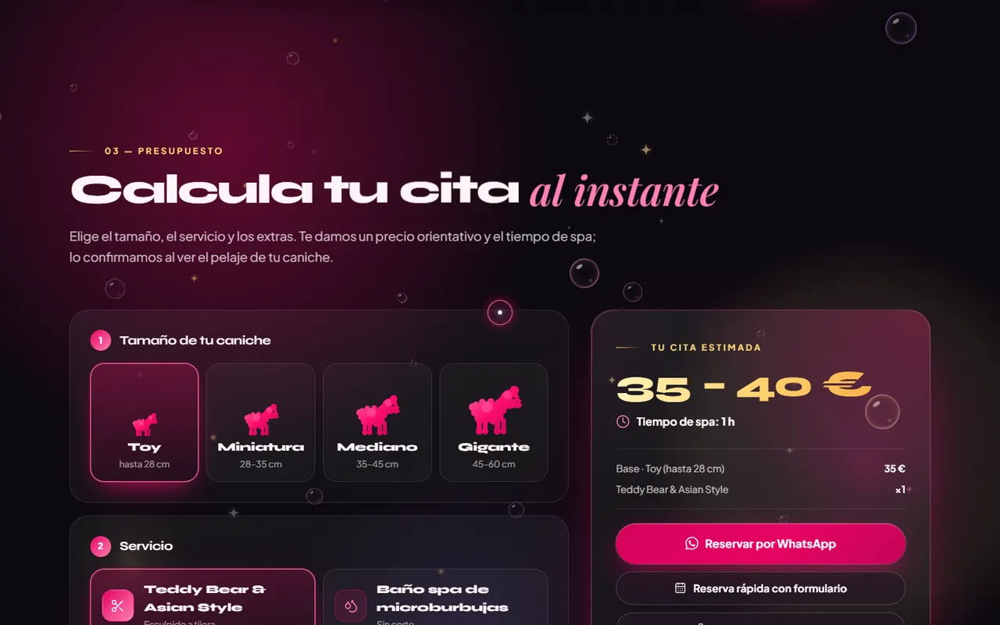
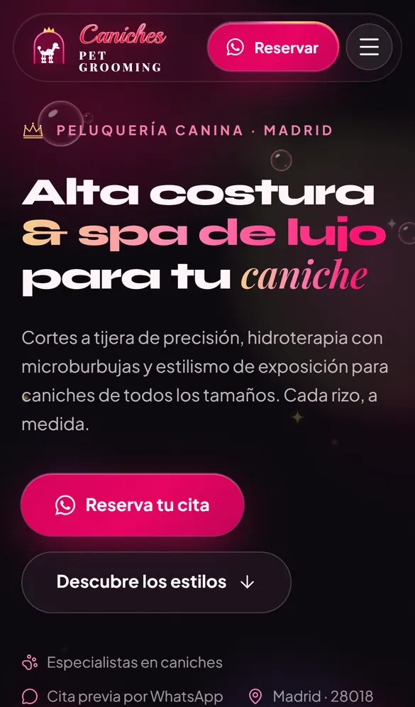

# Caniches Pet Grooming

Landing de una página para **Caniches Pet Grooming**, peluquería canina de Madrid especializada en caniches. Tiene un único objetivo de negocio: que quien la visita **reserve cita por WhatsApp**. Cada sección empuja hacia ese botón.

El concepto visual es **«el salón de la tarjeta, de noche»**: el mismo salón rosa de la tarjeta de presentación con las luces apagadas y el neón encendido. Lujo oscuro y glamour fucsia, con lo futurista en el comportamiento (spotlight, magnetismo, holo-foil, micro-etiquetas tipo HUD) y no en cambiar los colores de la marca.



| Dato | Detalle |
| --- | --- |
| Tipo | Web estática de una sola página (`index.html`) |
| Stack | HTML5 · CSS3 · JavaScript sin framework · Tailwind (Play CDN) · GSAP + ScrollTrigger · Lucide · Canvas 2D |
| Build | Ninguno: CSS y JS van inline y las librerías se cargan por CDN con versión fija |
| Idioma | Español de España (`lang="es"`), precios en € |
| Titular | Jonatan Rodríguez |
| Contacto | 674 001 918 (WhatsApp por defecto, pendiente de confirmar) · 691 913 010 · [@caniches_petgrooming](https://www.instagram.com/caniches_petgrooming/) |
| Dirección | Calle Gerardo Diego, 13 posterior, 28018 Madrid |
| Reservas | Con cita previa, por WhatsApp |

## Índice

1. [Vista previa](#vista-previa)
2. [Qué incluye la web](#qué-incluye-la-web)
3. [Tecnologías utilizadas](#tecnologías-utilizadas)
4. [Estructura del repositorio](#estructura-del-repositorio)
5. [Puesta en marcha](#puesta-en-marcha)
6. [Uso de la web](#uso-de-la-web)
7. [Configuración: el objeto `CONFIG`](#configuración-el-objeto-config)
8. [Sistema de diseño](#sistema-de-diseño)
9. [Accesibilidad](#accesibilidad)
10. [Resiliencia, rendimiento y SEO](#resiliencia-rendimiento-y-seo)
11. [Estado del proyecto y pendientes](#estado-del-proyecto-y-pendientes)
12. [Despliegue en producción](#despliegue-en-producción)
13. [Créditos y licencias](#créditos-y-licencias)

## Vista previa

Bento de servicios con spotlight (escritorio):



Calculadora de presupuesto con resultado en vivo (escritorio):



Hero en móvil (390 px de ancho):



## Qué incluye la web

| Bloque | Qué hace |
| --- | --- |
| **Navbar flotante** | Píldora de cristal con mini-logo, enlaces (Servicios · Estilos · Presupuesto · Opiniones · Visítanos) y botón «Reservar» con borde luminoso de gradiente cónico animado. Se oculta al bajar, reaparece al subir y resalta la sección activa. En móvil, hamburguesa que abre un menú a pantalla completa. |
| **Hero** | Titular «Alta costura & spa de lujo para tu *caniche*», botones de WhatsApp y de estilos, y la **tarjeta de presentación como pieza coleccionable 3D** (inclinación con el ratón, brillo especular, lámina holográfica y giro frente/dorso). Dos tarjetas pequeñas con fotos en parallax, chips de cristal flotantes y suelo de damero en perspectiva. |
| **01 — Servicios** | Bento grid asimétrico (12 columnas en escritorio) con un spotlight que sigue al cursor. Cuatro servicios más las teselas «Jonatan & equipo» e Instagram (con QR en escritorio). |
| **02 — Estilos** | Selector Puppy Clip · Teddy · León · Moderno. Cada estilo muestra descripción, tiempo de sesión, nivel de mantenimiento (1–5) y precio «desde», con contadores animados. |
| **03 — Presupuesto** | Calculadora en tres pasos (tamaño, servicio, extras) con precio en rango, tiempo de spa y desglose en vivo, enlace de WhatsApp con el resumen precargado y «Reserva rápida» (formulario en un `<dialog>`). |
| **04 — Opiniones** | Marquee infinito de dos filas en sentido opuesto con 8 reseñas de ejemplo claramente etiquetadas. |
| **05 — Visítanos** | Dirección con «Cómo llegar», teléfonos, WhatsApp, Instagram con QR, horario según configuración y mapa de Google en tono oscuro. |
| **CTA final y footer** | «Tu caniche merece pasarela» sobre el damero con botón de WhatsApp magnético. Footer con enlaces, contacto y aviso legal (diálogo). |
| **Capas globales** | Velo de entrada con corona de neón, aurora, grano, canvas de partículas que reaccionan al puntero, cursor personalizado (solo con ratón), botón flotante de WhatsApp en móvil y avisos (toast). |

## Tecnologías utilizadas

### Resumen

| Tecnología | Versión | Cómo se carga | Para qué se usa |
| --- | --- | --- | --- |
| HTML5 semántico | — | Inline | Landmarks (`header`, `nav`, `main`, `section`, `footer`), `<dialog>`, `<figure>`, atributo `inert`, `<symbol>`/`<use>` de SVG |
| CSS3 | — | `<style>` inline | Variables CSS, grid/flex, `clamp()`, transformaciones 3D, `@property`, `mask-composite`, `backdrop-filter`, `mix-blend-mode`, `clip-path`, unidades `svh`, `env(safe-area-inset-*)` y consultas `hover`, `pointer` y `prefers-reduced-motion` |
| JavaScript (sin framework) | ES2020+ | `<script>` inline | `CONFIG` y renderizado, cálculo de precios, canvas, cursor, tilt, navegación, diálogos y formulario |
| [Tailwind CSS](https://tailwindcss.com/) | 3.4.17 | Play CDN (`cdn.tailwindcss.com/3.4.17`) | Tokens de marca en `tailwind.config` y utilidades puntuales (maquetación del footer, `flex` en la navbar). Los efectos firma van en CSS propio |
| [GSAP](https://gsap.com/) | 3.14.2 | jsDelivr | Línea de tiempo de entrada, contadores animados, giro de la tarjeta, transiciones del selector de estilos y `gsap.matchMedia()` |
| GSAP ScrollTrigger | 3.14.2 | jsDelivr | Reveal en lote (`ScrollTrigger.batch`), titulares por palabra con máscara, parallax con `scrub` y enlace activo de la navbar |
| [Lucide](https://lucide.dev/) | 1.64.0 | unpkg (UMD) | Iconos de línea; `lucide.createIcons()` se llama tras cada render dinámico |
| [Google Fonts](https://fonts.google.com/) | — | `fonts.googleapis.com` con `display=swap` | Syne (600/700/800), Plus Jakarta Sans (400–800), Playfair Display (700/800 y cursiva 500/600) y Playball (400) |
| Canvas 2D | API del navegador | JS propio | Fondo de partículas: burbujas iridiscentes, polvo dorado con destellos de 4 puntas y bokeh |
| SVG inline | — | Inline | Corona, corazón con huella y destellos de neón; siluetas de caniche; huellas; logo recreado |
| JSON-LD, Open Graph y Twitter Card | — | `<head>` | SEO local y vista previa al compartir |
| Google Maps (iframe) | — | `https://www.google.com/maps?q=…&output=embed` | Mapa de la sección «Visítanos» |
| Unsplash | — | URLs directas de imagen | Fotos de caniches **ilustrativas** (no son trabajos del salón) |
| WhatsApp (`wa.me`) | — | Enlaces | Destino de la conversión, con mensaje precargado vía `encodeURIComponent` |

Sin `npm`, sin empaquetador y sin dependencias locales: los únicos archivos del proyecto son el HTML y los recursos de `img/`.

### APIs del navegador que se usan

`IntersectionObserver` (spotlight, pausas fuera de pantalla, botón flotante), Web Animations API (`getAnimations()` y `updatePlaybackRate()` para acelerar el marquee con el scroll), `<dialog>` con `showModal()`, `inert`, `matchMedia`, `DeviceOrientationEvent` (giroscopio opcional en móvil), `FormData`, `toLocaleDateString('es-ES')` y `performance.mark/measure` (marcas `cpg-render`, `cpg-modules` y `cpg-boot-total`, visibles en la pestaña Rendimiento de las DevTools).

### Decisiones técnicas

- **Un único archivo, sin build.** `index.html` contiene HTML, CSS y JS. Las imágenes viven en `img/` con rutas relativas.
- **Los datos están separados de la presentación.** Todo lo editable vive en el objeto `CONFIG` y el HTML se pinta desde él con funciones `render*` (`renderBack`, `renderHeroPhotos`, `renderBento`, `renderLab`, `renderCalc`, `renderMarquee`, `renderVisit`, `renderFooter`).
- **Bucle de animación compartido.** Cursor, canvas, tilt de la tarjeta, magnetismo y aceleración del marquee comparten un único bucle (el *ticker* de GSAP, con `requestAnimationFrame` como alternativa). El `dt` está acotado y el canvas no dibuja con la pestaña oculta.
- **GSAP con `matchMedia`.** Las animaciones se separan en escritorio (≥ 1024 px), móvil (< 1024 px) y movimiento reducido.
- **Efectos en CSS siempre que es posible.** Spotlight (`--mx/--my` + `radial-gradient` + `mask-composite`), damero (`conic-gradient` + `perspective`), aurora (tres `radial-gradient` con `translate/scale` lentos de 46–60 s), marquee (`translateX(-50%)` sobre una pista duplicada) y neón (SVG con `drop-shadow` en capas y parpadeo sutil).
- **Canvas propio con sprites prerenderizados.** Cantidad de partículas `min(90, área / 22000)` (≤ 45 en táctil), DPR limitado a 2 (1,5 en táctil), repulsión con muelle y amortiguación en un radio de 150 px y ráfaga de 9–12 destellos al hacer clic o tocar en zonas no interactivas.
- **Enlaces de WhatsApp reales.** El botón de la calculadora es un `<a href>` que se recalcula en cada cambio; sin JavaScript sigue habiendo un enlace de reserva en el aviso `<noscript>`.
- **Preferencias del usuario respetadas.** `prefers-reduced-motion`, `(hover: hover) and (pointer: fine)` para el cursor y los efectos de hover, y `(hover: none)` para sustituir el tilt por una flotación suave.

## Estructura del repositorio

```text
Caniches_pet_grooming/
├── index.html                    # Toda la web: HTML + CSS + JS (CONFIG al inicio del <script>)
├── README.md                     # Este documento
├── CLAUDE.md                     # Brief y especificación del proyecto (marca, sistema visual, reglas)
├── docs/
│   └── capturas/                 # Capturas que se muestran en este README (WebP)
└── img/
    ├── Caniches pet grooming.pdf # Tarjeta de presentación original (frente y dorso, rasterizada)
    ├── tarjeta-frente.webp       # Frente de la tarjeta: hero 3D y tesela «Jonatan & equipo»
    ├── tarjeta-dorso.webp        # Dorso extraído del PDF (la web reconstruye el dorso en HTML, así que no se usa)
    ├── og-image.jpg              # Imagen para redes sociales (Open Graph, 1200×630)
    └── qr-instagram.svg          # QR que abre el Instagram del negocio
```

### Organización interna de `index.html`

1. **`<head>`**: metadatos SEO y Open Graph, favicon SVG inline, script anti-FOUC, `preconnect`, Google Fonts, Tailwind Play CDN con su `tailwind.config`, GSAP, ScrollTrigger, Lucide y JSON-LD.
2. **`<style>`**: tokens (variables CSS), base y tipografía, aurora/grano/canvas, cursor, botones, navbar, hero (damero y tarjeta 3D), bento con spotlight, selector de estilos, calculadora, marquee, visita, CTA final y footer, diálogos, botón flotante y *reduced motion*.
3. **`<body>`**: símbolos SVG reutilizables, velo de entrada, navbar y menú móvil, las secciones (`#inicio`, `#servicios`, `#estilos`, `#presupuesto`, `#opiniones`, `#visitanos`, `#reservar`), footer, diálogos y botón flotante. Las secciones dinámicas llegan vacías y se rellenan desde `CONFIG`.
4. **`<script>`**: `CONFIG` → utilidades → funciones `render*` → `boot()`, que monta los módulos `Loop`, `Bg` (canvas), `Cursor` y magnetismo, `Spotlight`, `Hero`, `Nav`, `Dlg`, botón flotante, `Calc`, `Booking`, `Lab` y el movimiento con GSAP (`initMotion`).

## Puesta en marcha

Requisitos: un navegador actual y conexión a internet (CDNs, fuentes, fotos de Unsplash y mapa). No hay instalación ni compilación.

```bash
git clone https://github.com/Gregor20/Caniches_pet_grooming.git
cd Caniches_pet_grooming

# Sirve la carpeta con cualquier servidor estático, por ejemplo:
python -m http.server 8000
# o bien:
npx serve .
```

Abre <http://localhost:8000>. Se recomienda servirla por HTTP en lugar de abrir el archivo directamente.

Flujo de trabajo: edita `index.html`, recarga el navegador y listo. Para revisar el diseño responsive usa el modo dispositivo de las DevTools en 360, 390, 768, 1024, 1440 y 1920 px, y emula `prefers-reduced-motion: reduce` para comprobar la versión sin movimiento.

## Uso de la web

### Para quien la visita

**Reservar cita (el objetivo).** Hay tres caminos y los tres acaban en WhatsApp:

1. Los botones «Reservar», «Reserva tu cita» y «Reservar por WhatsApp» (navbar, hero, CTA final, footer y botón flotante en móvil) abren WhatsApp con un saludo genérico.
2. La **calculadora** genera un mensaje con el tamaño, el servicio, los extras, el estimado y el tiempo.
3. La **reserva rápida** abre un formulario (nombre, nombre del caniche, tamaño, servicio, día preferido, franja de mañana o tarde y notas), valida los campos obligatorios, compone el mensaje y abre WhatsApp. No se envía nada a ningún servidor.

También se puede llamar con `tel:` a los dos teléfonos o escribir por Instagram.

**Tarjeta de presentación 3D.**

- Con ratón, la tarjeta se inclina hasta unos 12° en horizontal y 10° en vertical; el brillo y la lámina holográfica siguen al puntero.
- Un clic o toque sobre la tarjeta, o el botón «Girar tarjeta», muestra el dorso con los teléfonos, el Instagram, la dirección y el QR. El dorso es HTML real: se puede seleccionar texto y los enlaces funcionan.
- En móvil la tarjeta flota sola. El botón opcional «Inclinar con el móvil» activa el giroscopio (en iOS el sistema pide permiso).

**Servicios.** Al mover el ratón por las tarjetas aparece el spotlight. «Calcular este servicio» preselecciona ese servicio en la calculadora y baja hasta ella.

**Estilos.** Elige Puppy Clip, Teddy, León o Moderno con clic, toque o teclado. Se actualizan la foto de referencia, la descripción, el tiempo de sesión, el medidor de mantenimiento con «retoque cada X semanas» y el precio «desde». «Calcular para mi caniche» preselecciona el servicio asociado y baja a la calculadora.

**Presupuesto.**

1. Elige el **tamaño**: Toy (hasta 28 cm), Miniatura (28–35 cm), Mediano (35–45 cm) o Gigante (45–60 cm), alturas según la FCI.
2. Elige el **servicio**.
3. Marca los **extras** que quieras (opcional).

El resultado se actualiza al instante: rango de precio, tiempo de spa y desglose. Siempre es orientativo y se confirma tras valorar el pelaje.

Ejemplo de mensaje que genera el botón «Reservar por WhatsApp» (Mediano + baño spa + mascarilla):

```text
Hola Jonatan 👋 Quiero reservar cita en Caniches Pet Grooming.
• Caniche: Mediano (35–45 cm)
• Servicio: Baño spa de microburbujas
• Extras: Mascarilla nutritiva del rizo
• Estimado: 40–45 € · 1 h 10 min
¿Qué disponibilidad tenéis?
```

**Opiniones.** Las dos filas avanzan en sentido contrario, se detienen al pasar el ratón o al enfocar una tarjeta y se aceleran un poco con el scroll. Las reseñas de ejemplo llevan la etiqueta «Ejemplo»; «Reseña verificada» solo aparece en reseñas reales marcadas como verificadas.

**Visítanos.** Dirección, teléfonos, WhatsApp, Instagram con QR y mapa. «Cómo llegar» abre las indicaciones en Google Maps. El horario no figura en la tarjeta, así que se muestra «Con cita previa · reserva por WhatsApp» hasta que se configure.

**Aviso legal.** El enlace del footer abre un diálogo con el titular, el domicilio, los contactos y el NIF (pendiente de completar).

**Teclado y lector de pantalla.**

- `Tab` y `Shift + Tab` recorren la página; el enlace «Saltar al contenido» es el primer elemento enfocable.
- En el selector de estilos, las flechas, `Inicio` y `Fin` cambian de pestaña.
- `Esc` cierra el menú móvil y los diálogos.

**Preferencias del sistema.**

- Con *reducir movimiento* no hay cursor personalizado, parallax ni tilt, el canvas se dibuja estático, el contenido es visible desde el principio y el marquee se desplaza a mano.
- En dispositivos táctiles no hay cursor personalizado, el spotlight se sustituye por un brillo fijo suave y las partículas (hasta 45) derivan solas y reaccionan al toque.

### Para quien mantiene la web

Los textos, precios, fotos, reseñas y datos de contacto se cambian en `CONFIG`; el siguiente apartado lo explica en detalle.

## Configuración: el objeto `CONFIG`

`CONFIG` está al principio del `<script>` de `index.html`. El HTML se pinta desde él, así que cambiar un valor se refleja en toda la web sin tocar el marcado.

| Clave | Qué controla |
| --- | --- |
| `brand.name`, `owner`, `greeting` | Nombre del negocio, titular y saludo de los mensajes de WhatsApp («Hola Jonatan») |
| `brand.phones[]` | Teléfonos como `{ display, e164, whatsapp }`. Todos generan enlaces `tel:`; el primero con `whatsapp: true` es el destino de `wa.me` |
| `brand.instagram` | `handle` y `url` del perfil |
| `brand.googleReviewsUrl` | Enlace del botón «Ver opiniones en Google». Si se deja vacío, el botón no se pinta |
| `brand.address` | `street`, `zip`, `city` y `mapsQuery` (mapa embebido y «Cómo llegar») |
| `brand.hours` | Horario en texto. Con `null` se muestra «Con cita previa · reserva por WhatsApp» |
| `brand.nif` | NIF del aviso legal. Con `null` se muestra «pendiente de completar» |
| `flags.showPlaceholderBadges` | Muestra la etiqueta «Ejemplo» y la nota de reseñas de ejemplo |
| `flags.claims` | Interruptores de textos sensibles (ver más abajo) |
| `photos` | Fotos de Unsplash: `id`, `w`, `h` y `alt` |
| `sizes[]` | Tamaños: `id`, `label`, `range`, `base` (€) y `min` (minutos) |
| `services[]` | Servicios: `id`, `icon` (nombre de Lucide), `title`, `claimTitle`, `blurb`, `tags`, `calcLabel`, `calcNote`, `priceFactor`, `timeFactor` y `photo` |
| `extras[]` | Extras: `id`, `label`, `price`, `min` y `claim` opcional |
| `styles[]` | Estilos: `id`, `label`, `sil` (silueta SVG), `photo`, `tagline`, `desc`, `factor`, `timeFactor`, `maintenance` (1–5), `weeks` y `service` |
| `testimonials[]` | Reseñas: `name`, `dog`, `breed`, `stars`, `text`, `placeholder` y `verified` |

### Cómo se calculan el precio y el tiempo

```text
precio base  = round(base_del_tamaño × priceFactor_del_servicio)
total        = precio base + suma(extras.price)
rango        = round5(total) – round5(total × 1,15)       (si coinciden, el máximo sube 5 €)
minutos      = round5(min_del_tamaño × timeFactor_del_servicio + suma(extras.min))

estilo «desde»   = round(base_Toy × factor_del_estilo)
sesión del estilo = round5(min_Toy × timeFactor_del_estilo)
```

`round5` redondea al múltiplo de 5 más cercano. El resultado siempre se presenta como orientativo.

### Valores por defecto (PLACEHOLDER, a validar con el cliente)

Ninguno de estos precios ni tiempos es real: son datos de partida para probar la web.

**Tamaños**

| Tamaño | Altura (FCI) | Base | Tiempo base |
| --- | --- | --- | --- |
| Toy | hasta 28 cm | 35 € | 60 min |
| Miniatura | 28–35 cm | 45 € | 75 min |
| Mediano | 35–45 cm | 55 € | 100 min |
| Gigante | 45–60 cm | 75 € | 140 min |

**Servicios y extras**

| Servicio / extra | Factor de precio | Factor de tiempo |
| --- | --- | --- |
| Teddy Bear & Asian Style | ×1 | ×1 |
| Baño spa de microburbujas | ×0,6 | ×0,6 |
| Exposición & Continental | ×1,6 | ×1,5 |
| Primera visita de cachorro | ×0,7 | ×0,8 |
| Mascarilla nutritiva del rizo | +8 € | +10 min |
| Desenredado profundo | +10 € | +20 min |
| Ozono (oculto por defecto, ver *claims*) | +12 € | +10 min |

**Rangos que muestra la calculadora con estos valores (sin extras)**

| Tamaño | Teddy & Asian | Baño spa | Exposición & Continental | Cachorro |
| --- | --- | --- | --- | --- |
| Toy | 35–40 € | 20–25 € | 55–65 € | 25–30 € |
| Miniatura | 45–50 € | 25–30 € | 70–85 € | 30–35 € |
| Mediano | 55–65 € | 35–40 € | 90–100 € | 40–45 € |
| Gigante | 75–85 € | 45–50 € | 120–140 € | 55–60 € |

**Estilos**

| Estilo | Factor | Desde (Toy) | Sesión (Toy) | Mantenimiento | Retoque | Servicio que preselecciona |
| --- | --- | --- | --- | --- | --- | --- |
| Puppy Clip | ×0,8 | 28 € | 50 min | 1 · Bajo | 6–8 semanas | Cachorro |
| Teddy | ×1 | 35 € | 1 h | 2 · Medio-bajo | 5–6 semanas | Teddy & Asian |
| León | ×1,5 | 53 € | 1 h 30 min | 4 · Alto | 4–5 semanas | Exposición & Continental |
| Moderno | ×1,25 | 44 € | 1 h 15 min | 3 · Medio | 5–6 semanas | Teddy & Asian |

### Textos sensibles (*claims*)

Los términos que pueden ser sensibles legal o comercialmente están desactivados en `flags.claims` y se activan o quitan sin tocar el HTML. Por defecto el texto habla de «microburbujas» y «cosmética suave».

| Flag | Efecto al activarlo |
| --- | --- |
| `ozono` | El servicio de spa pasa a llamarse «Hidroterapia con microburbujas y ozono» y aparece el extra «Ozono» en la calculadora |
| `hipoalergenico` | El servicio de cachorros pasa a llamarse «Cuidado hipoalergénico & cachorros» |
| `organica`, `biotecnologico` | Reservados: ningún texto los usa todavía |

Conviene confirmar con el cliente que puede respaldar cada afirmación antes de activarla.

### Recetas rápidas

- **Cambiar el WhatsApp.** En `brand.phones`, deja `whatsapp: true` solo en el teléfono que tenga WhatsApp. Los datos de contacto también están escritos a mano en dos sitios fuera de `CONFIG`: el bloque JSON-LD del `<head>` y el aviso `<noscript>`; actualízalos a la vez.
- **Cambiar precios y tiempos.** Ajusta `sizes[].base` y `min`, los factores de `services[]` y `styles[]` y el precio de `extras[]`. La calculadora, el selector de estilos, el formulario y el mensaje de WhatsApp se recalculan solos.
- **Publicar reseñas reales.** Sustituye las de ejemplo por opiniones reales de Google o Instagram (con permiso), añade `verified: true` y quita `placeholder: true`. Cuando ya no quede ninguna de ejemplo, pon `flags.showPlaceholderBadges` en `false`.
- **Añadir horario y NIF.** Rellena `brand.hours` y `brand.nif`.
- **Cambiar fotos.** Sustituye los `id` de `CONFIG.photos`. Con la implementación actual, `photoImg()` siempre construye URLs de Unsplash, así que para usar fotos propias hay que adaptar esa función (y `U()`) para aceptar rutas locales de `img/`.

## Sistema de diseño

### Paleta

| Token | Valor | Uso |
| --- | --- | --- |
| Obsidiana | `#09050B` | Fondo cálido (la mayor parte de la superficie) |
| Ciruela | `#150B14` / `#1E101C` | Superficies y diálogos |
| Marfil | `#FFF4F8` | Texto |
| Fucsia de marca | `#FE086C` | Neón, glows, bordes, iconos y texto grande; nunca en superficies grandes planas |
| Fucsia profundo | `#E6005F` | Botones rellenos con texto blanco |
| Rosa cuarzo · chicle · pétalo | `#FF7EB3` · `#FD98BC` · `#FAD8E3` | Acentos y degradados |
| Carmín del logo | `#AC011E` → `#E93357` | Degradado del script «Caniches» |
| Oro champán · oro neón | `#F5D08A` · `#FED371` | Detalles de lujo: precios, filetes, destellos y corona |
| Lavanda eléctrico | `#8A64FF` | Solo como luz ambiental de la aurora; nunca en botones ni texto |

Los tokens están definidos como variables CSS y en `tailwind.config`.

### Tipografía

- **Syne** (700/800) para titulares, con `clamp()` y tracking apretado.
- **Playfair Display Italic** para la palabra clave de cada titular (eco de la cursiva del nombre en la tarjeta).
- **Plus Jakarta Sans** (400–800) para el texto corrido.
- **Playball** solo para recrear el script «Caniches» del logo mientras no exista el original.
- Las micro-etiquetas tipo HUD («01 — SERVICIOS») van en mayúsculas con tracking amplio.

### Elementos firma

- **Damero rosa y negro en perspectiva 3D** con brillo, en el hero y en el CTA final.
- **Boiserie**: marcos de línea fina con luz de neón rosa como paneles de pared tras las secciones.
- **Neón SVG** con glow en capas y parpadeo muy sutil: corona champán, corazón con huella y destellos de 4 puntas (que también son la partícula del canvas).
- **Huellas de pata y corazones de línea** como motivo tenue.
- **Siluetas de caniche en SVG** (cachorro con lazo, continental, teddy y moderno).
- **Atmósfera**: aurora de tres `radial-gradient`, grano SVG al 5,5 %, bordes de cristal de 1 px y esquinas de 24–32 px.

## Accesibilidad

- Enlace «Saltar al contenido», `lang="es"`, secciones con `aria-labelledby` y foco visible con contorno dorado.
- **Pestañas** de estilos con `role="tablist"`, `tab` y `tabpanel`, `aria-selected`, `aria-controls`, tabulación itinerante y navegación con flechas, `Inicio` y `Fin`.
- **Calculadora** con controles nativos (radios y casillas), grupos con `role="radiogroup"` o `group` y resultado anunciado en una región `aria-live="polite"`.
- **Diálogos** con `<dialog>` nativo: `showModal()`, cierre con `Esc` o clic en el fondo y devolución del foco al elemento que los abrió.
- **Menú móvil** con `aria-expanded`, `aria-controls`, etiqueta dinámica, foco atrapado, `Esc` para cerrar y `inert` cuando está cerrado.
- **Tarjeta 3D**: la cara que no se ve queda `inert` y con `aria-hidden`; el botón «Girar tarjeta» usa `aria-pressed`.
- Imágenes con `alt` descriptivo (las decorativas, vacío o `aria-hidden`), estrellas con `role="img"` y `aria-label`, y copia duplicada del marquee con `aria-hidden`.
- Botones, pestañas, chips y enlaces con 44 px de alto o más (la excepción conocida son los enlaces de la navbar de escritorio, de 39 px) y texto del cuerpo de 16 px.
- `prefers-reduced-motion` respetado (ver «Uso de la web»).

## Resiliencia, rendimiento y SEO

### Resiliencia (por diseño)

- **Anti-FOUC.** `<html class="no-js">` pasa a `js` con un script del `<head>`. Los elementos `[data-reveal]` solo se ocultan bajo `.js`, y si GSAP o ScrollTrigger no cargan se retira `.js` (como máximo a los 3,5 s) y el contenido queda visible.
- **Sin JavaScript.** El aviso `<noscript>` ofrece WhatsApp, teléfono, Instagram y dirección.
- **Fotos.** Si una imagen de Unsplash falla, `onerror` activa una silueta SVG de marca o un degradado.
- **Librerías.** El código comprueba `window.gsap` y `window.lucide` antes de usarlas. Si Tailwind no cargara, solo se degradarían las pocas utilidades que se usan.

### Rendimiento (técnicas aplicadas)

- Imagen del hero con `preload`, `fetchpriority="high"` y `width/height`; el resto de imágenes con `loading="lazy"`.
- `backdrop-filter` limitado a la navbar, los chips y la insignia del selector, más las capas que solo existen mientras están abiertas (menú móvil y diálogos).
- Un solo bucle de animación compartido, DPR del canvas acotado, número de partículas acotado y animaciones CSS infinitas pausadas cuando su sección no está en pantalla.
- `ScrollTrigger.refresh()` tras `document.fonts.ready` y tras el evento `load`.
- Animaciones de transformación y opacidad (compositor) siempre que es posible.

### SEO local

- `title`, `description`, `theme-color` (`#09050B`), `color-scheme` y favicon SVG inline.
- Open Graph y Twitter Card con `img/og-image.jpg` (1200×630).
- JSON-LD `LocalBusiness` con nombre, descripción, teléfono, fundador, dirección y `sameAs` hacia Instagram.

## Estado del proyecto y pendientes

### Lo que se ha medido

Medición del 29/10/2026 en Chrome 156 (Windows, GPU Intel Iris Xe), escritorio a 1440×900 y web servida en local:

- El hero se pinta en 1,4 s (LCP, la tarjeta del hero) y el evento `load` llega a los 0,8 s.
- CLS de 0,0004.
- Sin errores en consola (solo el aviso de Tailwind Play CDN), sin recursos fallidos, 15 de 15 imágenes cargadas y sin scroll horizontal.
- 60 FPS en reposo y moviendo el ratón sobre el hero.
- En una prueba sintética de scroll continuo hubo caídas de FPS (en torno a 27 FPS bajando y 19 subiendo). No se ha investigado la causa: se dio por aceptable para esta fase y no se ha optimizado.

También se comprobó que las URLs de las CDN y las 10 fotos de Unsplash respondían con 200, y que el QR decodifica a `https://www.instagram.com/caniches_petgrooming/`.

### Lo que falta por verificar

- Fluidez y Lighthouse en móvil (la medición móvil se interrumpió).
- Pruebas funcionales completas en navegador: menú móvil, selector de estilos, calculadora y mensaje de WhatsApp, formulario de reserva y diálogos.
- Comportamiento con `prefers-reduced-motion` y con el fallo de una CDN.
- Otros navegadores (Safari, Firefox) y lector de pantalla.

### Pendiente del cliente y de contenido

- **WhatsApp**: confirmar cuál de los dos teléfonos lo tiene (por defecto, 674 001 918).
- **Precios y tiempos**: los actuales son de ejemplo.
- **Reseñas**: las 8 actuales son de ejemplo; hacen falta opiniones reales con permiso.
- **Horario**: no figura en la tarjeta.
- **NIF** para el aviso legal.
- **Logo original con transparencia**: ahora se recrea con SVG y tipografías.
- **Fotos reales del salón**: las de Unsplash son ilustrativas y no representan trabajos del negocio.
- **Textos sensibles** (*claims*): validar antes de activarlos.
- **Privacidad y cookies**: la web carga recursos de terceros (Google Fonts, Google Maps, CDNs y Unsplash) y no tiene política de privacidad ni banner de cookies. Conviene revisarlo con el titular o un asesor.

### Limitaciones técnicas conocidas

- **Tailwind por Play CDN**: aceptable para una página de un solo archivo, pero no recomendado en producción, y solo se usan unas pocas utilidades.
- **Cuatro familias tipográficas** (Syne, Plus Jakarta Sans, Playfair Display y Playball). Playball solo existe para recrear el script del logo.
- **Rendimiento del scroll** en escritorio sin optimizar (ver arriba).
- **Accesibilidad, pendientes menores**: algunas micro-etiquetas miden entre 11,5 y 13,8 px y los enlaces de la navbar de escritorio tienen 39 px de alto.
- **Datos duplicados a mano**: el contacto aparece también en el JSON-LD y en el `<noscript>`.
- **Fotos**: `photoImg()` solo admite Unsplash; para fotos propias hay que adaptarla.
- **`og:image` relativa**: debe pasar a URL absoluta al publicar para que funcione al compartir.
- **Compatibilidad**: pensada para navegadores actuales (usa `<dialog>`, `inert`, `@property`, `mask-composite`, `overflow: clip` y `svh`); solo se ha probado en Chrome.

## Despliegue en producción

Al ser un sitio estático, sirve cualquier hosting de archivos estáticos (GitHub Pages, Netlify, Vercel, Cloudflare Pages o un servidor propio). Antes de publicar:

1. Rellenar los datos reales: WhatsApp, precios, horario, NIF y reseñas, y retirar las etiquetas de ejemplo.
2. Sustituir las fotos de Unsplash por fotos propias optimizadas (WebP o AVIF) y, si existe, el logo original.
3. Sustituir el Play CDN de Tailwind por CSS compilado con la CLI de Tailwind, o reescribir en CSS las pocas utilidades que se usan.
4. Poner `og:image` con URL absoluta y añadir `og:url` y `<link rel="canonical">`.
5. Completar el JSON-LD (`url`, `image`, horario y, si procede, `priceRange`).
6. Servir por HTTPS con compresión (gzip o Brotli) y caché para `img/`.
7. Revisar privacidad y cookies con el titular o un asesor.
8. Pasar Lighthouse en móvil y revisar a mano 360, 390, 768, 1024, 1440 y 1920 px, el teclado y el movimiento reducido.

## Créditos y licencias

- **Código de la web**: este repositorio no incluye todavía un archivo de licencia; mientras no se añada, el código no tiene una licencia de uso abierta.
- **Marca e ilustración**: el nombre comercial, el logotipo y la ilustración de la tarjeta (`img/`) son del negocio y de sus autores, y no están cubiertos por ninguna licencia de reutilización.
- **Fotos de Unsplash**: ilustrativas, de sus autores y bajo la licencia de Unsplash. Se acreditan en el pie de la web («Fotos: Unsplash»).
- **Librerías**: Tailwind CSS (licencia MIT), GSAP y ScrollTrigger (licencia estándar de GSAP), Lucide (licencia ISC) y Google Fonts (licencias abiertas de cada tipografía).
